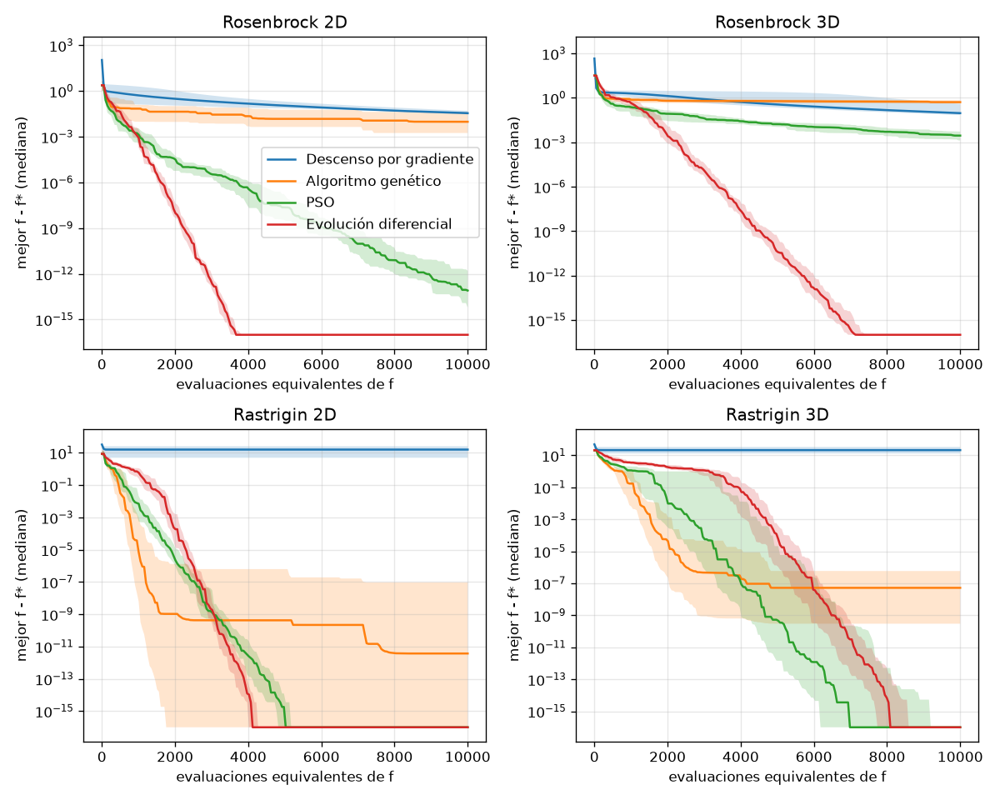
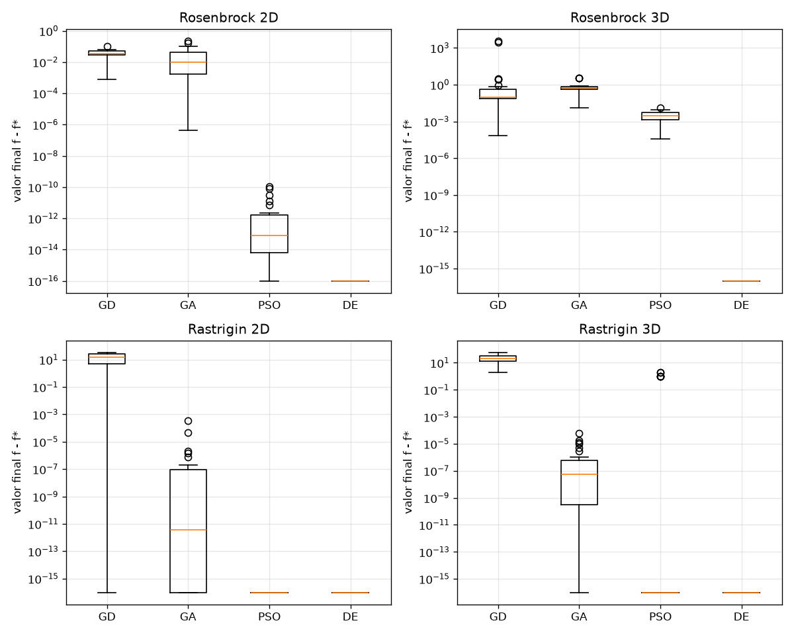
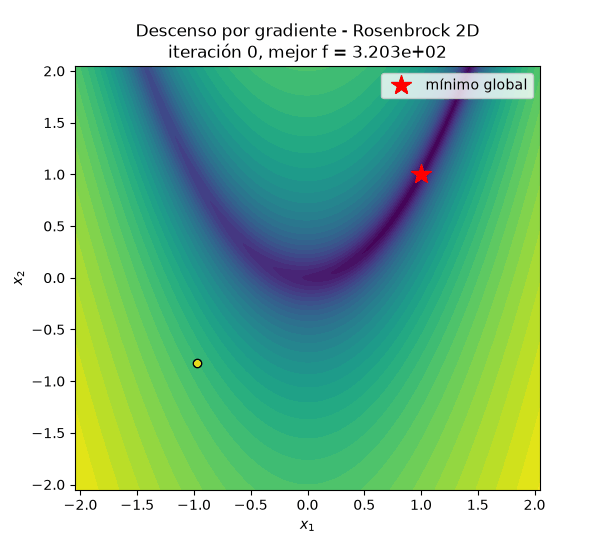
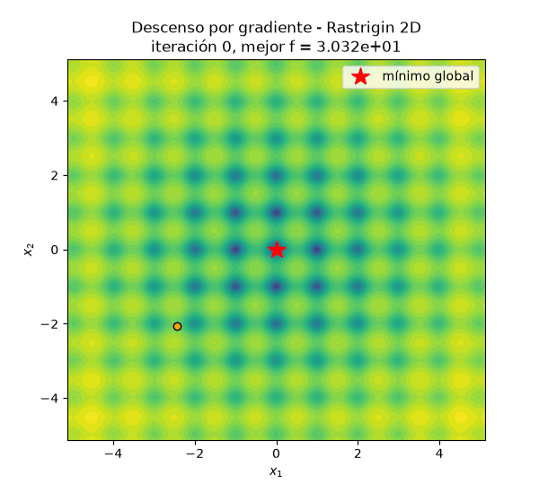
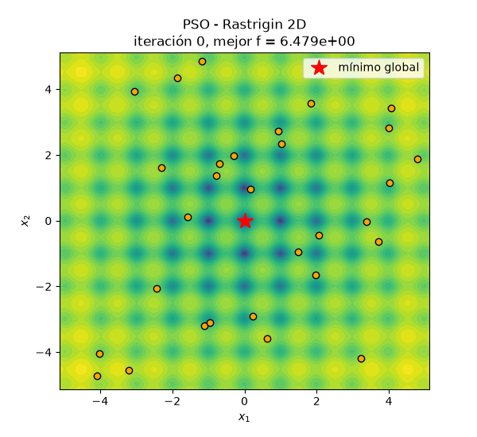
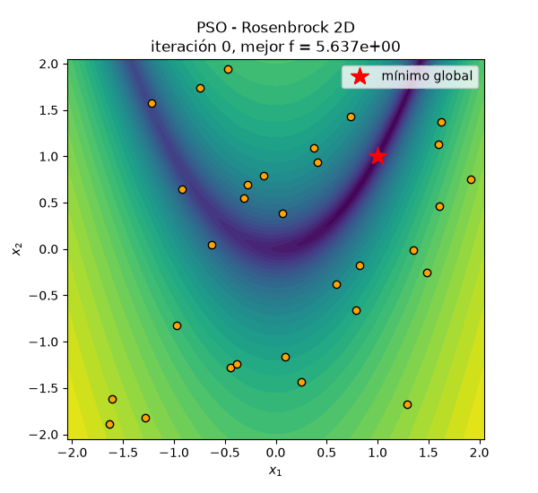

# Gradientes, enjambres y hormigas: de Rosenbrock a recorrer España en carro

**Repositorio:** <enlace al repositorio Git>

En este trabajo comparamos métodos de optimización que usan el gradiente con métodos metaheurísticos que solo evalúan la función. Primero lo hacemos con dos funciones de prueba clásicas, Rosenbrock y Rastrigin. Después pasamos a un problema combinatorio real: el recorrido más barato en carro por las 47 capitales de provincia de la España peninsular.

Todo el código, los datos y las instrucciones para reproducir cada figura están en el repositorio. Cada figura y cada tabla de este reporte se regenera con un solo comando (ver el README).

---

## Parte 1. Optimización numérica

### 1.1 Funciones de prueba

Escogimos dos funciones con geometrías opuestas, las dos definidas para cualquier dimensión $n$ (las de Goldstein-Price y las seis jorobas de camello solo existen en 2D, y necesitábamos 2D y 3D).

**Rosenbrock** (Rosenbrock, 1960):

$$f(\mathbf{x}) = \sum_{i=1}^{n-1}\left[100\,(x_{i+1}-x_i^2)^2 + (1-x_i)^2\right], \qquad \mathbf{x}\in[-2.048,\,2.048]^n$$

Mínimo global: $f(1,\dots,1)=0$. Tiene un solo mínimo, pero está al fondo de un valle largo, curvo y muy estrecho. En 2D la hessiana en el mínimo es

$$H(1,1)=\begin{pmatrix}802 & -400\\ -400 & 200\end{pmatrix},$$

con valores propios $\lambda_{\max}\approx 1001.6$ y $\lambda_{\min}\approx 0.399$. El número de condición es $\kappa\approx 2508$: la función es casi 2500 veces más empinada en una dirección que en la otra.

**Rastrigin** (Rastrigin, 1974; ver también Jamil y Yang, 2013):

$$f(\mathbf{x}) = 10n + \sum_{i=1}^{n}\left[x_i^2 - 10\cos(2\pi x_i)\right], \qquad \mathbf{x}\in[-5.12,\,5.12]^n$$

Mínimo global: $f(0,\dots,0)=0$. Es una parábola con una "rejilla" de cosenos encima, así que tiene un mínimo local cerca de cada punto de coordenadas enteras: unos $11^n$ mínimos locales dentro del dominio (121 en 2D y 1331 en 3D). Cada mínimo local es convexo localmente, pero la función en conjunto no lo es.

Los gradientes son

$$\frac{\partial f_{\text{Ros}}}{\partial x_i} = -400\,x_i(x_{i+1}-x_i^2) - 2(1-x_i) + 200(x_i - x_{i-1}^2),$$

donde el primer y segundo término solo existen si $i<n$ y el tercero solo si $i>1$, y

$$\frac{\partial f_{\text{Ras}}}{\partial x_i} = 2x_i + 20\pi\sin(2\pi x_i).$$

Antes de usarlos los comparamos con diferencias centrales en 100 puntos aleatorios para $n=2,3,5$ (`python pruebas.py`). El error relativo máximo fue del orden de $10^{-10}$.

### 1.2 Métodos

**Descenso por gradiente (GD).** Con tasa de aprendizaje fija $\eta$:

$$\mathbf{x}_{k+1} = \mathbf{x}_k - \eta\,\nabla f(\mathbf{x}_k).$$

Usamos $\eta=10^{-3}$ y un punto inicial uniforme en el dominio. Se detiene si $\lVert\nabla f\rVert<10^{-8}$, si se acaba el presupuesto o si $f$ deja de ser finito (divergencia). Para una cuadrática, GD es estable solo si $\eta<2/\lambda_{\max}$ (Nocedal y Wright, 2006). Cerca del mínimo de Rosenbrock eso da $\eta<0.002$.

**Algoritmo genético (GA)** con codificación real (Holland, 1975; Goldberg, 1989). En cada generación: selección por torneo de tamaño 3, cruce BLX-$\alpha$ con $\alpha=0.5$ y probabilidad 0.9, y mutación gaussiana por gen con probabilidad 0.1 y $\sigma = 0.1\times$(ancho del dominio). Con elitismo de 1 individuo y población de 30. En el cruce BLX-$\alpha$ cada gen del hijo es

$$h_j \sim U\big[\min(p_{1j},p_{2j}) - \alpha d_j,\ \max(p_{1j},p_{2j}) + \alpha d_j\big],\quad d_j=|p_{1j}-p_{2j}|.$$

**Optimización por enjambre de partículas (PSO)** (Kennedy y Eberhart, 1995) con peso de inercia:

$$\mathbf{v}_i \leftarrow w\,\mathbf{v}_i + c_1\mathbf{r}_1\odot(\mathbf{p}_i-\mathbf{x}_i) + c_2\mathbf{r}_2\odot(\mathbf{g}-\mathbf{x}_i),\qquad \mathbf{x}_i\leftarrow\mathbf{x}_i+\mathbf{v}_i,$$

donde $\mathbf{p}_i$ es la mejor posición de la partícula, $\mathbf{g}$ la mejor del enjambre y $\mathbf{r}_1,\mathbf{r}_2\sim U[0,1]^n$. Usamos $w=0.7298$ y $c_1=c_2=1.49618$ (Clerc y Kennedy, 2002), 30 partículas y velocidad máxima del 20 % del ancho del dominio.

**Evolución diferencial (DE)**, variante DE/rand/1/bin (Storn y Price, 1997). Para cada individuo $\mathbf{x}_i$:

$$\mathbf{v} = \mathbf{x}_{r_1} + F(\mathbf{x}_{r_2}-\mathbf{x}_{r_3}),\qquad u_j = \begin{cases} v_j & \text{si } U_j<CR \text{ o } j=j_{\text{rand}}\\ x_{ij} & \text{si no}\end{cases}$$

y $\mathbf{u}$ reemplaza a $\mathbf{x}_i$ si $f(\mathbf{u})\le f(\mathbf{x}_i)$. Usamos $F=0.8$, $CR=0.9$ y población de 30.

En los tres métodos de población, si un punto se sale del dominio lo devolvemos al borde.

### 1.3 Comparación justa: cómo contamos las evaluaciones

Cada método llama a la función a través de una clase `Problema` (en `optim/funciones.py`) que cuenta por separado las evaluaciones de $f$ ($n_f$) y las de $\nabla f$ ($n_\nabla$).

**Equivalencia propuesta:** una evaluación de $\nabla f$ cuesta $2n$ evaluaciones de $f$, que es lo que cuesta aproximar el gradiente con diferencias centrales:

$$\frac{\partial f}{\partial x_i}\approx\frac{f(\mathbf{x}+h\mathbf{e}_i)-f(\mathbf{x}-h\mathbf{e}_i)}{2h}.$$

Elegimos esta equivalencia porque es lo que pagaría alguien que no tiene la fórmula del gradiente, y porque es fácil de verificar en el código. Hay un argumento a favor de un costo menor: con diferenciación automática en modo reverso el gradiente cuesta un número pequeño y constante de evaluaciones de $f$, sin importar $n$ (Griewank y Walther, 2008). En 2D y 3D las dos opciones dan números parecidos ($2n$ = 4 o 6). En todo caso, en la Tabla 1 reportamos $n_f$ y $n_\nabla$ por separado, así que el lector puede usar otra equivalencia.

El costo de una corrida es entonces

$$\text{costo} = n_f + 2n\cdot n_\nabla .$$

Todos los métodos tienen el mismo presupuesto: **10 000 evaluaciones equivalentes**. GD evalúa además $f$ en cada iteración para poder dibujar la curva de convergencia, y esas evaluaciones también se cuentan, así que cada iteración le cuesta $2n+1$.

**Protocolo.** 30 corridas independientes por configuración (función × dimensión × método). La corrida $k$ usa la semilla $2026+k$, la misma para todos los métodos. Definimos **éxito** como $f(\mathbf{x}_{\text{final}}) - f^* < 10^{-3}$.

### 1.4 Resultados

<!-- tabla generada por: python parte1_experimentos.py  (resultados/parte1/tabla_resultados.md) -->

**Tabla 1.** Valor final $f-f^*$ en 30 corridas por configuración, con presupuesto de 10 000 evaluaciones equivalentes.

| Función | Dim | Método | Media | Desv. est. | Mejor | Peor | Éxito (%) | Evals $f$ | Evals $\nabla f$ |
|---|---|---|---|---|---|---|---|---|---|
| Rosenbrock | 2 | Descenso por gradiente | 3.69e-02 | 2.15e-02 | 7.81e-04 | 9.87e-02 | 3 | 2000 | 1999 |
| Rosenbrock | 2 | Algoritmo genético | 3.22e-02 | 5.18e-02 | 4.24e-07 | 2.28e-01 | 23 | 9977 | 0 |
| Rosenbrock | 2 | PSO | 8.28e-12 | 2.47e-11 | 3.67e-17 | 1.12e-10 | 100 | 9990 | 0 |
| Rosenbrock | 2 | Evolución diferencial | 0.00e+00 | 0.00e+00 | 0.00e+00 | 0.00e+00 | 100 | 9990 | 0 |
| Rosenbrock | 3 | Descenso por gradiente | 2.18e+02 | 8.37e+02 | 7.20e-05 | 3.73e+03 | 7 | 1334 | 1333 |
| Rosenbrock | 3 | Algoritmo genético | 7.69e-01 | 9.08e-01 | 1.22e-02 | 3.49e+00 | 0 | 9977 | 0 |
| Rosenbrock | 3 | PSO | 3.55e-03 | 2.93e-03 | 3.93e-05 | 1.28e-02 | 17 | 9990 | 0 |
| Rosenbrock | 3 | Evolución diferencial | 6.65e-23 | 2.02e-22 | 2.08e-26 | 1.10e-21 | 100 | 9990 | 0 |
| Rastrigin | 2 | Descenso por gradiente | 1.54e+01 | 1.12e+01 | 0.00e+00 | 3.38e+01 | 7 | 50 | 50 |
| Rastrigin | 2 | Algoritmo genético | 1.34e-05 | 6.40e-05 | 0.00e+00 | 3.49e-04 | 100 | 9977 | 0 |
| Rastrigin | 2 | PSO | 0.00e+00 | 0.00e+00 | 0.00e+00 | 0.00e+00 | 100 | 9990 | 0 |
| Rastrigin | 2 | Evolución diferencial | 0.00e+00 | 0.00e+00 | 0.00e+00 | 0.00e+00 | 100 | 9990 | 0 |
| Rastrigin | 3 | Descenso por gradiente | 2.35e+01 | 1.50e+01 | 1.99e+00 | 5.87e+01 | 0 | 52 | 52 |
| Rastrigin | 3 | Algoritmo genético | 3.58e-06 | 1.10e-05 | 0.00e+00 | 5.75e-05 | 100 | 9977 | 0 |
| Rastrigin | 3 | PSO | 2.65e-01 | 5.80e-01 | 0.00e+00 | 1.99e+00 | 80 | 9990 | 0 |
| Rastrigin | 3 | Evolución diferencial | 0.00e+00 | 0.00e+00 | 0.00e+00 | 0.00e+00 | 100 | 9990 | 0 |

*Fuente: elaboración propia con `python parte1_experimentos.py`. Los valores "0.00e+00" son ceros exactos en punto flotante. Las columnas de evaluaciones son promedios por corrida.*

**Figura 1.** Mediana (línea) y rango intercuartílico (sombra) del mejor valor encontrado contra el número de evaluaciones equivalentes. *Fuente: elaboración propia.*

**Figura 2.** Distribución del valor final en las 30 corridas (los ceros se dibujan como $10^{-16}$). *Fuente: elaboración propia.*

**Figura 3.** Descenso por gradiente en Rosenbrock 2D, desde $(-0.98, -0.83)$ con $\eta=10^{-3}$. *Fuente: elaboración propia con `python parte1_animacion.py`.*

**Figura 4.** Descenso por gradiente en Rastrigin 2D. Se queda en el mínimo local más cercano al punto inicial. *Fuente: elaboración propia.*

**Figura 5.** PSO en Rastrigin 2D: el enjambre explora varios "huecos" y luego se concentra en el origen. *Fuente: elaboración propia.*

**Figura 6.** PSO en Rosenbrock 2D. *Fuente: elaboración propia.*

### 1.5 Discusión

**Rosenbrock: un solo mínimo, pero mal condicionado.** Como se ve en la Figura 3, GD baja muy rápido hasta el fondo del valle en unas pocas iteraciones y después avanza muy despacio por él. La razón es el condicionamiento: el paso estable lo fija la dirección empinada ($\eta<2/\lambda_{\max}$), y con ese paso el avance en la dirección plana es de orden $\eta\lambda_{\min}\approx 4\times10^{-4}$ por iteración. Por eso, después de ~2000 gradientes en 2D, la media sigue en $3.7\times10^{-2}$ y solo 1 de 30 corridas cumple el umbral (Tabla 1). En 3D pasó algo peor: 2 de las 30 corridas divergieron en menos de 10 iteraciones porque empezaron en zonas donde $\lambda_{\max}$ es mucho mayor que cerca del mínimo, y el mismo $\eta$ ya no es estable. Esas dos corridas son las que inflan la media a 218. Así, el tamaño de paso de GD depende de la geometría y no hay uno bueno para todo el dominio.

Entre las metaheurísticas, DE fue la mejor: llegó al cero de máquina en 2D en ~3500 evaluaciones y en 3D en ~7000 (Figura 1). El vector diferencia $\mathbf{x}_{r_2}-\mathbf{x}_{r_3}$ se alinea solo con el valle, porque los individuos se reparten a lo largo de él, y eso le da pasos en la dirección correcta sin calcular ninguna derivada. PSO funcionó muy bien en 2D y mucho peor en 3D (17 % de éxito). El GA con BLX y mutación gaussiana fue el más débil en Rosenbrock: su mutación no tiene ninguna dirección preferida y el valle es muy estrecho.

**Rastrigin: muchos mínimos locales.** Aquí GD no tiene opción. Con $\eta=10^{-3}$ el paso máximo es $\eta\cdot\max|\partial f/\partial x_i|\approx 0.07$, que no alcanza para saltar de un hueco a otro, así que converge al mínimo local del hueco donde empezó en unas 50 iteraciones (Figura 4) y se detiene porque el gradiente se anula. Usó solo unas 250 evaluaciones equivalentes en 2D (370 en 3D) de las 10 000. Las 2 corridas exitosas en 2D fueron las que empezaron, por suerte, dentro de la cuenca del origen ($|x_i|<0.5$; puntos iniciales $(-0.135, 0.339)$ y $(0.034, -0.194)$). La probabilidad de que eso pase es de alrededor de $(1/10.24)^2\approx 1\%$ en 2D. Los tres métodos de población resolvieron Rastrigin 2D en el 100 % de las corridas. En 3D, PSO falló en 6 de 30 corridas, quedando en $f\approx 0.995$ o $1.99$, que son los mínimos locales vecinos al origen (una o dos coordenadas en $\pm1$). El GA, que sufrió en Rosenbrock, aquí fue de los mejores: su mutación grande le permite saltar entre huecos.

**¿Qué aportó cada familia?**

- El **gradiente** aporta información local muy barata: en Rastrigin llegó a un mínimo local con 50 gradientes, y en un problema convexo y bien condicionado sería imbatible. Pero no sabe nada de lo que pasa fuera de su cuenca, y su velocidad depende del número de condición.
- Las **metaheurísticas** aportan exploración global y no necesitan derivadas, a cambio de muchas más evaluaciones de $f$. Su desempeño depende del operador: DE se adapta a la escala y orientación del problema porque usa diferencias entre individuos; PSO converge rápido pero puede estancarse; el GA explora bien pero afina mal.
- Una estrategia razonable en la práctica es combinarlas: una metaheurística para encontrar la cuenca correcta y luego gradiente (o un método de segundo orden) para afinar. También se podría hacer GD con varios reinicios. Con el presupuesto que GD dejó sin usar en Rastrigin se podrían haber hecho unos 40 reinicios en 2D, aunque con un 1 % de probabilidad por reinicio de caer en la cuenca correcta seguiría siendo peor que PSO o DE.

---

## Parte 2. Optimización combinatoria: recorrer España

PARTE2_AQUI
