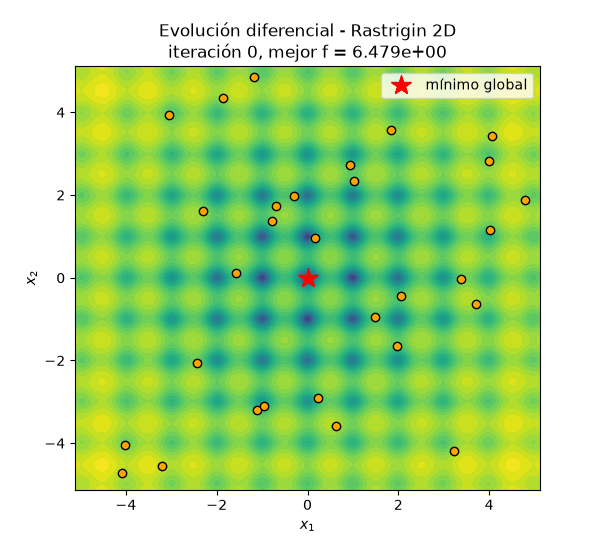
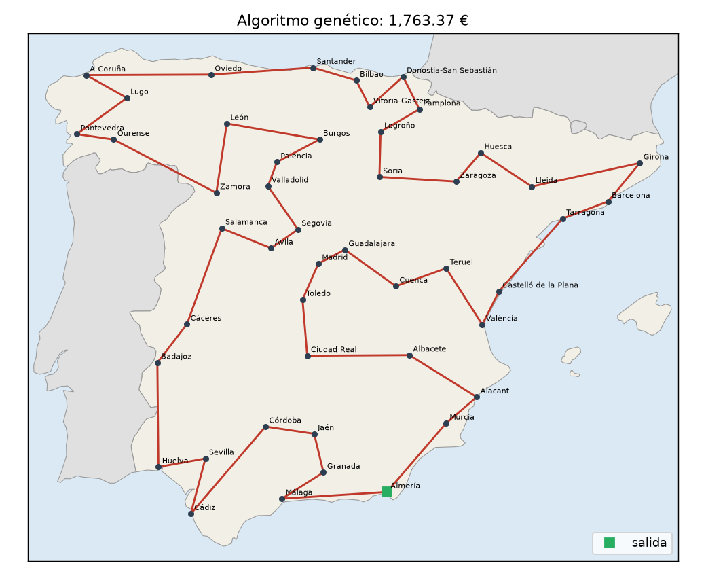
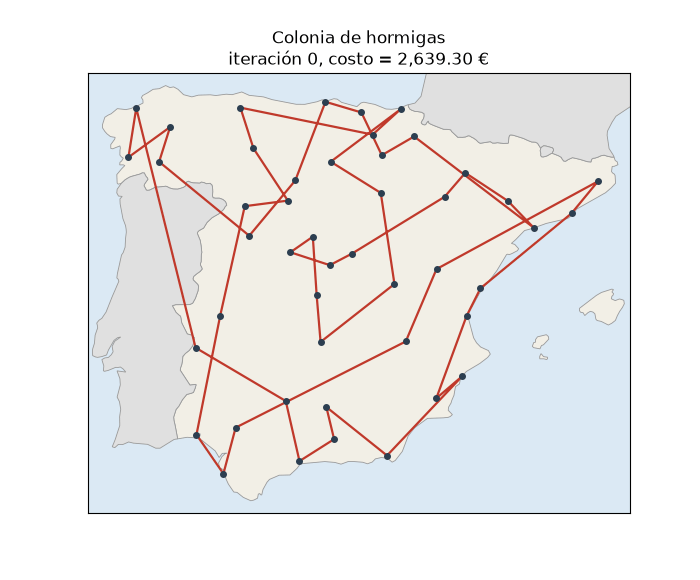
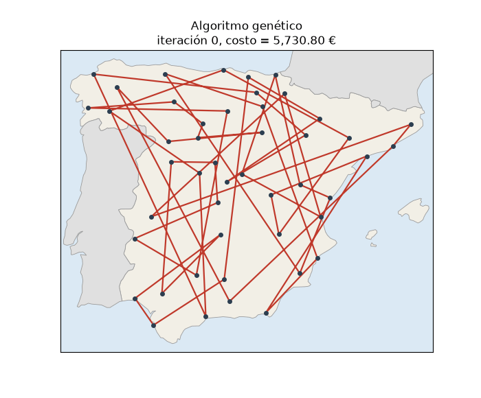
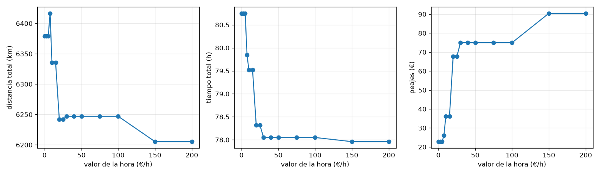
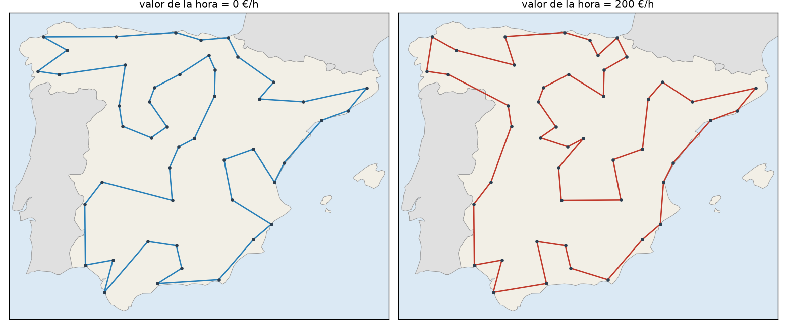

# Gradientes, enjambres y hormigas: de Rosenbrock a recorrer España en carro

**Autores:** Santiago Vanegas Vasquez (C.C. 1000760600), Juan Pablo Perez Alvarez (C.C. 1045493511) y Sebastian Rodriguez Suarez (C.C. 1020107446)

**Repositorio:** [https://github.com/srodriguezsu/redes-neuronales-1](https://github.com/srodriguezsu/redes-neuronales-1)

En este trabajo comparamos métodos de optimización que usan el gradiente con métodos metaheurísticos que solo evalúan la función. Primero lo hacemos con dos funciones de prueba clásicas, Rosenbrock y Rastrigin. Después pasamos a un problema combinatorio real: el recorrido más barato en carro por las 47 capitales de provincia de la España peninsular.

Todo el código, los datos y las instrucciones para reproducir cada figura están en el repositorio. Cada figura y cada tabla de este reporte se regenera con un solo comando (ver el README).

---

## Parte 1. Optimización numérica

### 1.1 Funciones de prueba

Escogimos dos funciones con geometrías opuestas, las dos definidas para cualquier dimensión $n$ (las de Goldstein-Price y las seis jorobas de camello solo existen en 2D, y necesitábamos 2D y 3D).

**Rosenbrock** (Rosenbrock, 1960):

$$f(\mathbf{x}) = \sum_{i=1}^{n-1}\left[100\,(x_{i+1}-x_i^2)^2 + (1-x_i)^2\right], \qquad \mathbf{x}\in[-2.048,\,2.048]^n$$

Mínimo global: $f(1,\dots,1)=0$. Tiene un solo mínimo, pero está al fondo de un valle largo, curvo y muy estrecho. En 2D la hessiana en el mínimo es

$$H(1,1)=\begin{pmatrix}802 & -400\\ -400 & 200\end{pmatrix},$$

con valores propios $\lambda_{\max}\approx 1001.6$ y $\lambda_{\min}\approx 0.399$. El número de condición es $\kappa\approx 2508$: la función es casi 2500 veces más empinada en una dirección que en la otra.

**Rastrigin** (Rastrigin, 1974; ver también Jamil y Yang, 2013):

$$f(\mathbf{x}) = 10n + \sum_{i=1}^{n}\left[x_i^2 - 10\cos(2\pi x_i)\right], \qquad \mathbf{x}\in[-5.12,\,5.12]^n$$

Mínimo global: $f(0,\dots,0)=0$. Es una parábola con una "rejilla" de cosenos encima, así que tiene un mínimo local cerca de cada punto de coordenadas enteras: unos $11^n$ mínimos locales dentro del dominio (121 en 2D y 1331 en 3D). Cada mínimo local es convexo localmente, pero la función en conjunto no lo es.

Los gradientes son

$$\frac{\partial f_{\text{Ros}}}{\partial x_i} = -400\,x_i(x_{i+1}-x_i^2) - 2(1-x_i) + 200(x_i - x_{i-1}^2),$$

donde el primer y segundo término solo existen si $i<n$ y el tercero solo si $i>1$, y

$$\frac{\partial f_{\text{Ras}}}{\partial x_i} = 2x_i + 20\pi\sin(2\pi x_i).$$

Antes de usarlos los comparamos con diferencias centrales en 100 puntos aleatorios para $n=2,3,5$ (`python pruebas.py`). El error relativo máximo fue del orden de $10^{-10}$.

### 1.2 Métodos

**Descenso por gradiente (GD).** Con tasa de aprendizaje fija $\eta$:

$$\mathbf{x}_{k+1} = \mathbf{x}_k - \eta\,\nabla f(\mathbf{x}_k).$$

Usamos $\eta=10^{-3}$ y un punto inicial uniforme en el dominio. Se detiene si $\lVert\nabla f\rVert<10^{-8}$, si se acaba el presupuesto o si $f$ deja de ser finito (divergencia). Para una cuadrática, GD es estable solo si $\eta<2/\lambda_{\max}$ (Nocedal y Wright, 2006). Cerca del mínimo de Rosenbrock eso da $\eta<0.002$.

**Algoritmo genético (GA)** con codificación real (Holland, 1975; Goldberg, 1989). En cada generación: selección por torneo de tamaño 3, cruce BLX-$\alpha$ con $\alpha=0.5$ y probabilidad 0.9, y mutación gaussiana por gen con probabilidad 0.1 y $\sigma = 0.1\times$(ancho del dominio). Con elitismo de 1 individuo y población de 30. En el cruce BLX-$\alpha$ cada gen del hijo es

$$h_j \sim U\big[\min(p_{1j},p_{2j}) - \alpha d_j,\ \max(p_{1j},p_{2j}) + \alpha d_j\big],\quad d_j=|p_{1j}-p_{2j}|.$$

Cada padre sale de un torneo: se toman $k=3$ índices al azar $I=\{i_1,i_2,i_3\}$ y gana $\arg\min_{i\in I} f(\mathbf{x}_i)$. Después, cada gen del hijo muta con probabilidad $p_m=0.1$:

$$h_j \leftarrow h_j + \varepsilon_j,\qquad \varepsilon_j\sim\mathcal{N}(0,\sigma^2),\quad \sigma = 0.1\,(u-l),$$

donde $[l,u]$ es el dominio de cada coordenada.

**Optimización por enjambre de partículas (PSO)** (Kennedy y Eberhart, 1995) con peso de inercia:

$$\mathbf{v}_i \leftarrow w\,\mathbf{v}_i + c_1\mathbf{r}_1\odot(\mathbf{p}_i-\mathbf{x}_i) + c_2\mathbf{r}_2\odot(\mathbf{g}-\mathbf{x}_i),\qquad \mathbf{x}_i\leftarrow\mathbf{x}_i+\mathbf{v}_i,$$

donde $\mathbf{p}_i$ es la mejor posición de la partícula, $\mathbf{g}$ la mejor del enjambre y $\mathbf{r}_1,\mathbf{r}_2\sim U[0,1]^n$. Usamos $w=0.7298$ y $c_1=c_2=1.49618$ (Clerc y Kennedy, 2002), 30 partículas y velocidad máxima del 20 % del ancho del dominio.

**Evolución diferencial (DE)**, variante DE/rand/1/bin (Storn y Price, 1997). Para cada individuo $\mathbf{x}_i$:

$$\mathbf{v} = \mathbf{x}_{r_1} + F(\mathbf{x}_{r_2}-\mathbf{x}_{r_3}),\qquad u_j = \begin{cases} v_j & \text{si } U_j<CR \text{ o } j=j_{\text{rand}}\\ x_{ij} & \text{si no}\end{cases}$$

y $\mathbf{u}$ reemplaza a $\mathbf{x}_i$ si $f(\mathbf{u})\le f(\mathbf{x}_i)$. Usamos $F=0.8$, $CR=0.9$ y población de 30.

En los tres métodos de población, si un punto se sale del dominio lo devolvemos al borde.

### 1.3 Comparación justa: cómo contamos las evaluaciones

Cada método llama a la función a través de una clase `Problema` (en `optim/funciones.py`) que cuenta por separado las evaluaciones de $f$ ($n_f$) y las de $\nabla f$ ($n_\nabla$).

**Equivalencia propuesta:** una evaluación de $\nabla f$ cuesta $2n$ evaluaciones de $f$, que es lo que cuesta aproximar el gradiente con diferencias centrales:

$$\frac{\partial f}{\partial x_i}\approx\frac{f(\mathbf{x}+h\mathbf{e}_i)-f(\mathbf{x}-h\mathbf{e}_i)}{2h}.$$

Elegimos esta equivalencia porque es lo que pagaría alguien que no tiene la fórmula del gradiente, y porque es fácil de verificar en el código. Hay un argumento a favor de un costo menor: con diferenciación automática en modo reverso el gradiente cuesta un número pequeño y constante de evaluaciones de $f$, sin importar $n$ (Griewank y Walther, 2008). En 2D y 3D las dos opciones dan números parecidos ($2n$ = 4 o 6). En todo caso, en la Tabla 1 reportamos $n_f$ y $n_\nabla$ por separado, así que el lector puede usar otra equivalencia.

El costo de una corrida es entonces

$$\text{costo} = n_f + 2n\cdot n_\nabla .$$

Todos los métodos tienen el mismo presupuesto: **10 000 evaluaciones equivalentes**. GD evalúa además $f$ en cada iteración para poder dibujar la curva de convergencia, y esas evaluaciones también se cuentan, así que cada iteración le cuesta $2n+1$.

**Protocolo.** 30 corridas independientes por configuración (función × dimensión × método). La corrida $k$ usa la semilla $2026+k$, la misma para todos los métodos. Definimos **éxito** como $f(\mathbf{x}_{\text{final}}) - f^* < 10^{-3}$.

### 1.4 Resultados

<!-- tabla generada por: python parte1_experimentos.py  (resultados/parte1/tabla_resultados.md) -->

**Tabla 1.** Valor final $f-f^*$ en 30 corridas por configuración, con presupuesto de 10 000 evaluaciones equivalentes.

| Función | Dim | Método | Media | Desv. est. | Mejor | Peor | Éxito (%) | Evals $f$ | Evals $\nabla f$ |
|---|---|---|---|---|---|---|---|---|---|
| Rosenbrock | 2 | Descenso por gradiente | 3.69e-02 | 2.15e-02 | 7.81e-04 | 9.87e-02 | 3 | 2000 | 1999 |
| Rosenbrock | 2 | Algoritmo genético | 3.22e-02 | 5.18e-02 | 4.24e-07 | 2.28e-01 | 23 | 9977 | 0 |
| Rosenbrock | 2 | PSO | 8.28e-12 | 2.47e-11 | 3.67e-17 | 1.12e-10 | 100 | 9990 | 0 |
| Rosenbrock | 2 | Evolución diferencial | 0.00e+00 | 0.00e+00 | 0.00e+00 | 0.00e+00 | 100 | 9990 | 0 |
| Rosenbrock | 3 | Descenso por gradiente | 2.18e+02 | 8.37e+02 | 7.20e-05 | 3.73e+03 | 7 | 1334 | 1333 |
| Rosenbrock | 3 | Algoritmo genético | 7.69e-01 | 9.08e-01 | 1.22e-02 | 3.49e+00 | 0 | 9977 | 0 |
| Rosenbrock | 3 | PSO | 3.55e-03 | 2.93e-03 | 3.93e-05 | 1.28e-02 | 17 | 9990 | 0 |
| Rosenbrock | 3 | Evolución diferencial | 6.65e-23 | 2.02e-22 | 2.08e-26 | 1.10e-21 | 100 | 9990 | 0 |
| Rastrigin | 2 | Descenso por gradiente | 1.54e+01 | 1.12e+01 | 0.00e+00 | 3.38e+01 | 7 | 50 | 50 |
| Rastrigin | 2 | Algoritmo genético | 1.34e-05 | 6.40e-05 | 0.00e+00 | 3.49e-04 | 100 | 9977 | 0 |
| Rastrigin | 2 | PSO | 0.00e+00 | 0.00e+00 | 0.00e+00 | 0.00e+00 | 100 | 9990 | 0 |
| Rastrigin | 2 | Evolución diferencial | 0.00e+00 | 0.00e+00 | 0.00e+00 | 0.00e+00 | 100 | 9990 | 0 |
| Rastrigin | 3 | Descenso por gradiente | 2.35e+01 | 1.50e+01 | 1.99e+00 | 5.87e+01 | 0 | 52 | 52 |
| Rastrigin | 3 | Algoritmo genético | 3.58e-06 | 1.10e-05 | 0.00e+00 | 5.75e-05 | 100 | 9977 | 0 |
| Rastrigin | 3 | PSO | 2.65e-01 | 5.80e-01 | 0.00e+00 | 1.99e+00 | 80 | 9990 | 0 |
| Rastrigin | 3 | Evolución diferencial | 0.00e+00 | 0.00e+00 | 0.00e+00 | 0.00e+00 | 100 | 9990 | 0 |

*Fuente: elaboración propia con `python parte1_experimentos.py`. Los valores "0.00e+00" son ceros exactos en punto flotante. Las columnas de evaluaciones son promedios por corrida.*


**Figura 1.** Mediana (línea) y rango intercuartílico (sombra) del mejor valor encontrado contra el número de evaluaciones equivalentes. *Fuente: elaboración propia.*


**Figura 2.** Distribución del valor final en las 30 corridas (los ceros se dibujan como $10^{-16}$). *Fuente: elaboración propia.*


**Figura 3.** Descenso por gradiente en Rosenbrock 2D, desde $(-0.98, -0.83)$ con $\eta=10^{-3}$. *Fuente: elaboración propia con `python parte1_animacion.py`.*


**Figura 4.** Descenso por gradiente en Rastrigin 2D. Se queda en el mínimo local más cercano al punto inicial. *Fuente: elaboración propia.*


**Figura 5.** PSO en Rastrigin 2D: el enjambre explora varios "huecos" y luego se concentra en el origen. *Fuente: elaboración propia.*


**Figura 6.** PSO en Rosenbrock 2D. *Fuente: elaboración propia.*



**Figura 7.** Evolución diferencial en Rastrigin 2D (semilla 2): la población pasa de estar repartida por todo el dominio a concentrarse en el origen. *Fuente: elaboración propia con `python parte1_animacion.py --funcion rastrigin --metodo de`.*

### 1.5 Discusión

**Rosenbrock: un solo mínimo, pero mal condicionado.** Como se ve en la Figura 3, GD baja muy rápido hasta el fondo del valle en unas pocas iteraciones y después avanza muy despacio por él. La razón es el condicionamiento: el paso estable lo fija la dirección empinada ($\eta<2/\lambda_{\max}$), y con ese paso el avance en la dirección plana es de orden $\eta\lambda_{\min}\approx 4\times10^{-4}$ por iteración. Por eso, después de ~2000 gradientes en 2D, la media sigue en $3.7\times10^{-2}$ y solo 1 de 30 corridas cumple el umbral (Tabla 1). En 3D pasó algo peor: 2 de las 30 corridas divergieron en menos de 10 iteraciones porque empezaron en zonas donde $\lambda_{\max}$ es mucho mayor que cerca del mínimo, y el mismo $\eta$ ya no es estable. Esas dos corridas son las que inflan la media a 218; son los dos puntos aislados cerca de $10^3$ en el panel de Rosenbrock 3D de la Figura 2. Así, el tamaño de paso de GD depende de la geometría y no hay uno bueno para todo el dominio.

Entre las metaheurísticas, DE fue la mejor: llegó al cero de máquina en 2D en ~3500 evaluaciones y en 3D en ~7000 (Figura 1). El vector diferencia $\mathbf{x}_{r_2}-\mathbf{x}_{r_3}$ se alinea solo con el valle, porque los individuos se reparten a lo largo de él, y eso le da pasos en la dirección correcta sin calcular ninguna derivada. PSO funcionó muy bien en 2D y mucho peor en 3D (17 % de éxito). En 2D, como se observa en la Figura 6, el enjambre no necesita recorrer el valle: hacia la iteración 30 ya está agrupado alrededor de $(1,1)$ y desde ahí solo afina. El GA con BLX y mutación gaussiana fue el más débil en Rosenbrock: su mutación no tiene ninguna dirección preferida y el valle es muy estrecho.

**Rastrigin: muchos mínimos locales.** Aquí GD no tiene opción. Con $\eta=10^{-3}$ el paso máximo es $\eta\cdot\max|\partial f/\partial x_i|\approx 0.07$, que no alcanza para saltar de un hueco a otro, así que converge al mínimo local del hueco donde empezó en unas 50 iteraciones (Figura 4) y se detiene porque el gradiente se anula. Usó solo unas 250 evaluaciones equivalentes en 2D (370 en 3D) de las 10 000. Las 2 corridas exitosas en 2D fueron las que empezaron, por suerte, dentro de la cuenca del origen ($|x_i|<0.5$; puntos iniciales $(-0.135, 0.339)$ y $(0.034, -0.194)$). La probabilidad de que eso pase es de alrededor de $(1/10.24)^2\approx 1\%$ en 2D. Los tres métodos de población resolvieron Rastrigin 2D en el 100 % de las corridas. La Figura 5 muestra cómo el enjambre de PSO explora varios huecos antes de concentrarse en el origen, y la Figura 7 muestra lo mismo con DE: al principio la población está dispersa, los vectores diferencia $\mathbf{x}_{r_2}-\mathbf{x}_{r_3}$ son grandes y los saltos pasan por encima de los mínimos locales; a medida que la población se agrupa, los saltos se achican solos y DE termina afinando dentro de la cuenca del origen. En 3D, PSO falló en 6 de 30 corridas, quedando en $f\approx 0.995$ o $1.99$, que son los mínimos locales vecinos al origen (una o dos coordenadas en $\pm1$); son los puntos aislados del panel de Rastrigin 3D en la Figura 2. El GA, que sufrió en Rosenbrock, aquí fue de los mejores: su mutación grande le permite saltar entre huecos.

**¿Qué aportó cada familia?**

- El **gradiente** aporta información local muy barata: en Rastrigin llegó a un mínimo local con 50 gradientes, y en un problema convexo y bien condicionado sería imbatible. Pero no sabe nada de lo que pasa fuera de su cuenca, y su velocidad depende del número de condición.
- Las **metaheurísticas** aportan exploración global y no necesitan derivadas, a cambio de muchas más evaluaciones de $f$. Su desempeño depende del operador: DE se adapta a la escala y orientación del problema porque usa diferencias entre individuos; PSO converge rápido pero puede estancarse; el GA explora bien pero afina mal.
- Una estrategia razonable en la práctica es combinarlas: una metaheurística para encontrar la cuenca correcta y luego gradiente (o un método de segundo orden) para afinar. También se podría hacer GD con varios reinicios. Con el presupuesto que GD dejó sin usar en Rastrigin se podrían haber hecho unos 40 reinicios en 2D, aunque con un 1 % de probabilidad por reinicio de caer en la cuenca correcta seguiría siendo peor que PSO o DE.

---

## Parte 2. Optimización combinatoria: recorrer España

### 2.1 Formulación del problema del viajero

Tenemos $N=47$ ciudades (las capitales de provincia peninsulares) y un costo $C_{ij}\ge 0$ de ir de $i$ a $j$. Un recorrido cerrado es una permutación $\pi=(\pi_1,\dots,\pi_N)$ de las ciudades, y su costo es

$$L(\pi) = \sum_{k=1}^{N-1} C_{\pi_k\pi_{k+1}} + C_{\pi_N\pi_1}.$$

El problema es encontrar $\pi^* = \arg\min_\pi L(\pi)$. Como el recorrido es cerrado, da igual en qué ciudad empiece, y como nuestros costos son simétricos ($C_{ij}=C_{ji}$) también da igual el sentido. Quedan $(N-1)!/2\approx 2.7\times10^{57}$ recorridos distintos, así que no se pueden revisar todos.

**Costo de un trayecto.** Para cada par de ciudades,

$$C_{ij}(h) = h\,t_{ij} + p_{ij} + d_{ij}\,\frac{c}{100}\,P,$$

donde $h$ es el valor de la hora del vendedor (€/h), $t_{ij}$ el tiempo de viaje (h), $p_{ij}$ el peaje (€), $d_{ij}$ la distancia (km), $c$ el consumo del vehículo (l/100 km) y $P$ el precio del combustible (€/l).

### 2.2 Datos

La Tabla 2 resume de dónde sale cada dato. Todos están guardados en la carpeta `datos/` del repositorio, así que los experimentos no necesitan internet.

**Tabla 2.** Fuentes de los datos del TSP.

| Dato | Valor / archivo | Fuente | Fecha de consulta |
|---|---|---|---|
| Coordenadas de las 47 capitales | `capitales.csv` | Nominatim (OpenStreetMap contributors, 2026) | 2026-10-06 |
| Distancia y tiempo por carretera | `distancia_km.csv`, `tiempo_h.csv` | OSRM (Luxen y Vetter, 2011), servidor público, perfil de carro | 2026-10-06 |
| Km por cada vía en cada ruta | `km_por_via.csv` | OSRM | 2026-10-06 |
| Tarifas de peaje 2026 | `peajes_tarifas.csv` (una URL por vía) | Ministerio de Transportes y Movilidad Sostenible (2026a, 2026b, 2026c), Sociedad Estatal de Infraestructuras del Transporte Terrestre [SEITT] (2026) y las concesionarias: Abertis Autopistas España (2025), Acega (2026), Aucalsa (2026), Audasa (2026), Audenasa (2025), Autopista del Sol (2026) y Bidegi (2026) | 2026-10-11 |
| Vehículo | SEAT León 2.0 TDI 85 kW (115 CV), diésel, **4.6 l/100 km** (WLTP combinado) | km77.com (2024) | 2026-10-06 |
| Precio del gasóleo | **1.934 €/l** (gasóleo de automoción con impuestos, España) | Comisión Europea (2026), Weekly Oil Bulletin, precios al 28/09/2026 | 2026-10-06 |
| Valor de la hora | 15 €/h por defecto, estudiado entre 0 y 200 €/h. Como referencia, el coste laboral por hora en España fue 26.18 €/h en promedio y 22.20 €/h en el sector Comercio (2.º trimestre de 2026) | parámetro; referencia: Instituto Nacional de Estadística [INE] (2026), Encuesta Trimestral de Coste Laboral | 2026-10-11 |

*Fuente: elaboración propia.*

**Peajes.** Esta fue la parte más difícil. Entre 2018 y 2021 se liberaron muchas autopistas (la AP-1 Burgos–Armiñón, la AP-4, la AP-7 al norte de Alicante, la AP-2...) y en 2026 se liberó la circunvalación de Alicante. Lo que hicimos fue:

1. Pedir a OSRM la ruta de cada uno de los 1081 pares de ciudades, paso a paso. Cada paso trae el código de la vía (por ejemplo `AP-68`) y su longitud.
2. Sumar los km que van por autopistas que siguen siendo de pago en 2026. Las que solo cobran en parte se separan por latitud: la AP-7 tiene tres tramos de pago (Alicante–Cartagena, Cartagena–Vera y Málaga–Guadiaro) y la AP-1 solo cobra entre Eibar y Vitoria.
3. Multiplicar por una tarifa en €/km: el importe oficial 2026 del recorrido completo para vehículos ligeros dividido entre la longitud oficial del tramo. Va de 0.075 €/km (AP-7 Alicante–Cartagena) a 0.288 €/km (AP-8). En seis vías (AP-6, AP-61, AP-51, AP-8, AP-1 y C-32) los km que da OSRM no cuadran con la longitud oficial, por cómo está etiquetada la vía en OpenStreetMap, así que calibramos la tarifa con el precio de un viaje completo (por ejemplo, 15.70 € Villalba–Adanero entre los 68.4 km de AP-6 de la ruta Madrid–Valladolid). Solo la M-12 queda con el promedio de las demás, porque no encontramos su tarifa.

**Validación.** Comparamos el peaje del modelo con el precio oficial de cuatro viajes que no usamos para calibrar (`python validar_peajes.py`): A Coruña–Pontevedra da 16.70 € contra 16.35 € (+2.1 %), Bilbao–Zaragoza 40.09 € contra 39.90 € (+0.5 %), Oviedo–León 15.85 € contra 16.20 € (−2.2 %) y Bilbao–Logroño 17.35 € contra 19.60 € (−11.5 %). El último error se debe a que la AP-68 no cobra lo mismo por km en todos sus tramos, y nosotros usamos una tarifa media. Con este método, 576 de los 1081 trayectos pagan algo de peaje.

Las limitaciones están documentadas en el README: usamos una tarifa por km constante en cada tramo, la longitud de la AP-15 es dudosa (las fuentes dan entre 83.5 y 112 km según el recorrido) y OSRM siempre da la ruta más rápida sin mirar el peaje (no exploramos rutas alternativas sin peaje para cada par). En el mapa dibujamos cada trayecto como una línea recta entre ciudades, aunque el costo usa la ruta real por carretera.

### 2.3 Métodos

**Colonia de hormigas (Ant System)** (Dorigo et al., 1996; Dorigo y Stützle, 2004). En cada iteración, $m$ hormigas construyen un recorrido. Estando en $i$, la hormiga $k$ va a una ciudad $j$ no visitada con probabilidad

$$p_{ij}^k = \frac{\tau_{ij}^{\alpha}\,\eta_{ij}^{\beta}}{\sum_{l\,\text{no visitada}} \tau_{il}^{\alpha}\,\eta_{il}^{\beta}},\qquad \eta_{ij}=\frac{1}{C_{ij}},$$

donde $\tau_{ij}$ es la feromona de la arista. Al final de la iteración la feromona se evapora y cada hormiga deposita una cantidad inversamente proporcional al costo de su recorrido $L_k$:

$$\tau_{ij} \leftarrow (1-\rho)\,\tau_{ij} + \sum_{k=1}^{m}\Delta\tau_{ij}^k,\qquad \Delta\tau_{ij}^k=\begin{cases}Q/L_k & \text{si } (i,j)\text{ está en el recorrido de } k\\ 0 & \text{si no.}\end{cases}$$

Usamos $m=30$, $\alpha=1$, $\beta=3$, $\rho=0.1$, $Q=1$, 150 iteraciones y feromona inicial $\tau_0=m/L_{nn}$, con $L_{nn}$ el costo del recorrido del vecino más cercano (Dorigo y Stützle, 2004).

**Algoritmo genético con permutaciones.** Cada individuo es un recorrido. Usamos selección por torneo de tamaño 5, cruce OX (*order crossover*; Davis, 1985) con probabilidad 0.9, mutación por inversión de un segmento con probabilidad 0.3, elitismo de 2 individuos, población de 100 y 300 generaciones. El cruce OX copia un segmento del primer padre y completa el resto de ciudades en el orden en que aparecen en el segundo, así que el hijo siempre es una permutación válida.

En símbolos, sean $\pi^1$ y $\pi^2$ los padres, ganadores de torneos de $k=5$ individuos distintos ($\arg\min_{i\in I} L(\pi^i)$, igual que en la Parte 1). Se escogen dos posiciones al azar $a<b$ y el hijo $h$ es

$$h_{a..b} = \pi^1_{a..b},\qquad (h_{b+1},\dots,h_N,h_1,\dots,h_{a-1}) = \big(\pi^2 \setminus \{\pi^1_a,\dots,\pi^1_b\}\big),$$

donde $\pi^2\setminus S$ es la lista de ciudades de $\pi^2$ que no están en $S$, en el orden en que aparecen en $\pi^2$. La mutación por inversión escoge otras dos posiciones $a<b$ y voltea el segmento:

$$\pi' = (\pi_1,\dots,\pi_{a-1},\ \pi_b,\pi_{b-1},\dots,\pi_a,\ \pi_{b+1},\dots,\pi_N).$$

Con elitismo, los 2 mejores recorridos pasan sin cambios a la siguiente generación.

**Búsqueda local 2-opt** (Croes, 1958). Quita dos aristas $(a,b)$ y $(c,d)$ y reconecta como $(a,c)$ y $(b,d)$, que equivale a invertir el tramo entre $b$ y $c$. Acepta el cambio si

$$\Delta = C_{ac}+C_{bd}-C_{ab}-C_{cd} < 0,$$

y repite hasta que no haya mejora. En la colonia de hormigas aplicamos 2-opt al mejor recorrido de cada iteración. En el genético la aplicamos a cada hijo con probabilidad 0.05 (ver el Hallazgo 4 en la cacería de la alucinación para saber por qué así).

### 2.4 Resultados

Con $h=15$ €/h, el mejor recorrido que encontramos cuesta **1 799.54 €**. Lo encontraron las dos metaheurísticas con 2-opt, en varias de las 10 corridas (Tabla 4). Con la semilla 2026, el genético llegó a 1 799.97 € (Figura 8), solo 0.43 € más, y la colonia de hormigas a 1 801.56 €. La Tabla 3 muestra el desglose del recorrido de la Figura 8.

**Tabla 3.** Desglose del recorrido del algoritmo genético con la semilla 2026 y $h=15$ €/h.

| Concepto | Valor |
|---|---|
| Distancia total | 6 263.9 km |
| Tiempo de conducción | 78.83 h |
| Costo del tiempo | 1 182.44 € |
| Peajes | 60.27 € |
| Combustible | 557.26 € |
| **Costo total** | **1 799.97 €** |

*Fuente: elaboración propia con `python parte2_tsp.py`.*

Orden: Jaén → Córdoba → Ciudad Real → Albacete → Murcia → Alacant → València → Castelló de la Plana → Tarragona → Barcelona → Girona → Lleida → Huesca → Zaragoza → Teruel → Cuenca → Guadalajara → Madrid → Toledo → Ávila → Segovia → Valladolid → Palencia → Burgos → Soria → Logroño → Pamplona → Donostia-San Sebastián → Vitoria-Gasteiz → Bilbao → Santander → Oviedo → A Coruña → Pontevedra → Ourense → Lugo → León → Zamora → Salamanca → Cáceres → Badajoz → Huelva → Sevilla → Cádiz → Málaga → Almería → Granada → (Jaén). Como el recorrido es cerrado, se puede empezar en cualquier ciudad.



**Figura 8.** Recorrido del algoritmo genético con 2-opt y la semilla 2026, con $h=15$ €/h. *Fuente: elaboración propia; contorno de Natural Earth (s. f.).*



**Figura 9.** Evolución de la mejor solución de la colonia de hormigas sin 2-opt: cada cuadro es una mejora. *Fuente: elaboración propia con `python parte2_tsp.py --sin-2opt --gif`.*



**Figura 10.** Evolución de la mejor solución del algoritmo genético sin 2-opt. *Fuente: elaboración propia.*

**¿Es el óptimo?** No podemos demostrarlo, porque no resolvimos el problema con un método exacto. Lo que sí hicimos fue correr cada configuración 10 veces con semillas distintas (Tabla 4). El recorrido de 1 799.54 € apareció 6 de 10 veces con ACO + 2-opt y 8 de 10 con GA + 2-opt, y ninguna corrida encontró algo mejor. Eso nos da bastante confianza de que es el óptimo o está muy cerca.

**Tabla 4.** Costo final en 10 corridas por configuración ($h=15$ €/h). La brecha se mide contra el mejor costo encontrado (1 799.54 €).

| Configuración | Media (€) | Desv. (€) | Mejor (€) | Peor (€) | Brecha media | Veces que llega al mejor | s/corrida |
|---|---|---|---|---|---|---|---|
| ACO + 2-opt | 1 800.74 | 1.75 | 1 799.54 | 1 804.53 | 0.07 % | 6/10 | 4.6 |
| ACO sin 2-opt | 1 895.34 | 20.86 | 1 861.94 | 1 922.63 | 5.32 % | 0/10 | 4.2 |
| GA + 2-opt | 1 799.63 | 0.18 | 1 799.54 | 1 799.97 | 0.00 % | 8/10 | 5.3 |
| GA sin 2-opt | 2 007.82 | 46.72 | 1 939.57 | 2 096.52 | 11.57 % | 0/10 | 1.8 |

*Fuente: elaboración propia con `python parte2_comparacion.py`.*

Sin 2-opt, la colonia de hormigas queda en promedio a 5.3 % del mejor y el genético a 11.6 %. La colonia de hormigas por sí sola es bastante mejor que el genético: su regla de construcción usa el costo de cada arista ($\eta_{ij}$), mientras que el cruce OX y la inversión no saben nada de costos y solo los "ven" a través de la selección. Las Figuras 9 y 10 muestran esa diferencia con la semilla 2026. La colonia de hormigas arranca ya en 2 690.75 €, porque cada hormiga construye su recorrido prefiriendo los trayectos baratos, y su última mejora llega en la iteración 64 (1 922.63 €). El genético arranca de permutaciones aleatorias, con trayectos que cruzan toda la península (5 730.80 €), y necesita hasta la generación 286 para llegar a 1 999.15 €. Con 2-opt los dos quedan a menos de 0.1 % en promedio. En la práctica, la búsqueda local hace la mayor parte del trabajo y la metaheurística le da buenos puntos de partida.

### 2.5 ¿Cambia la ruta con el valor de la hora?

Para 15 valores de $h$ entre 0 y 200 €/h corrimos la colonia de hormigas y el genético (los dos con 2-opt). Para no confundir el ruido de los algoritmos con un cambio real, al final evaluamos todos los recorridos encontrados (30 en total) con el costo de cada $h$ y nos quedamos con el más barato.

Para un recorrido fijo $\pi$, el costo es una recta en $h$:

$$L_\pi(h) = \underbrace{\textstyle\sum (p_{ij} + d_{ij}cP/100)}_{\text{dinero } M_\pi} + h\,\underbrace{\textstyle\sum t_{ij}}_{\text{horas } T_\pi}.$$

El óptimo para cada $h$ es la recta más baja, así que la ruta óptima solo cambia donde se cruzan dos rectas, en $h^* = (M_B - M_A)/(T_A - T_B)$. Valores bajos de $h$ premian rutas baratas en dinero (menos peajes) y valores altos premian rutas rápidas.

**Tabla 5.** Mejor recorrido encontrado para cada valor de la hora. "Aristas distintas" cuenta cuántos trayectos cambian respecto al recorrido con $h=0$.

| Valor hora (€/h) | km | horas | peajes (€) | combustible (€) | costo total (€) | aristas distintas |
|---|---|---|---|---|---|---|
| 0 | 6 463.9 | 82.03 | 21.73 | 575.05 | 596.78 | 0 |
| 2.5 | 6 363.4 | 80.27 | 31.56 | 566.11 | 798.36 | 14 |
| 5 | 6 363.4 | 80.27 | 31.56 | 566.11 | 999.04 | 14 |
| 7.5 | 6 363.4 | 80.27 | 31.56 | 566.11 | 1 199.72 | 14 |
| 10 | 6 363.4 | 80.27 | 31.56 | 566.11 | 1 400.41 | 14 |
| 15 | 6 315.5 | 79.30 | 48.48 | 561.85 | 1 799.77 | 13 |
| 20 | 6 242.3 | 78.32 | 69.83 | 555.34 | 2 191.66 | 17 |
| 25 | 6 242.3 | 78.32 | 69.83 | 555.34 | 2 583.29 | 17 |
| 30 | 6 247.0 | 78.05 | 77.20 | 555.76 | 2 974.47 | 17 |
| 40 | 6 247.0 | 78.05 | 77.20 | 555.76 | 3 754.98 | 17 |
| 50 | 6 247.0 | 78.05 | 77.20 | 555.76 | 4 535.48 | 17 |
| 75 | 6 247.0 | 78.05 | 77.20 | 555.76 | 6 486.74 | 17 |
| 100 | 6 247.0 | 78.05 | 77.20 | 555.76 | 8 438.00 | 17 |
| 150 | 6 205.3 | 77.96 | 94.74 | 552.05 | 12 340.41 | 19 |
| 200 | 6 205.3 | 77.96 | 94.74 | 552.05 | 16 238.29 | 19 |

*Fuente: elaboración propia con `python parte2_valor_hora.py`.*

La Tabla 6 da los valores exactos de $h$ en los que cambia la ruta, calculados con los cruces de las rectas de recorridos consecutivos.

**Tabla 6.** Valores de la hora en los que cambia el mejor recorrido encontrado.

| Cambio | $h^*$ (€/h) | Horas ahorradas | Dinero extra (€) |
|---|---|---|---|
| 1.º | 0.51 | 1.75 | 0.89 |
| 2.º | 12.95 | 0.98 | 12.66 |
| 3.º | 15.28 | 0.97 | 14.85 |
| 4.º | 28.42 | 0.27 | 7.78 |
| 5.º | 148.85 | 0.09 | 13.83 |

*Fuente: elaboración propia con `python parte2_valor_hora.py`.*



**Figura 11.** Distancia, tiempo y peajes del mejor recorrido según el valor de la hora. *Fuente: elaboración propia.*



**Figura 12.** Mejor recorrido con $h=0$ (solo dinero) y con $h=200$ €/h (casi solo tiempo). *Fuente: elaboración propia.*

Así, **sí cambia la ruta**. El primer cambio ocurre casi de inmediato, en $h^*\approx 0.5$ €/h: con $h=0$ solo cuenta el dinero, y basta darle un valor mínimo al tiempo para preferir un recorrido 1.75 h más rápido que cuesta apenas 0.89 € más (entran Vitoria–Donostia por la AP-1 y Cádiz–Málaga por la AP-7 de la Costa del Sol). Los cambios importantes están entre 13 y 15.3 €/h: en $h^*\approx 12.95$ €/h entran Zaragoza–Soria y Córdoba–Málaga (AP-46), y en $h^*\approx 15.28$ €/h entran A Coruña–Pontevedra (AP-9) y Barcelona–Tarragona (C-32). Cada uno de esos dos cambios ahorra casi 1 h a cambio de 13–15 €. Nuestro valor por defecto, 15 €/h, cae justo en esa franja, así que la ruta recomendada es sensible a ese parámetro. Por encima de unos 30 €/h los cambios ya son muy pequeños (0.27 h y 0.09 h).

Como se ve en la Tabla 5 y en la Figura 11, los cambios son pequeños en términos relativos: entre $h=0$ y $h=200$ el tiempo total baja 4.1 h (de 82.03 a 77.96 h), y los peajes pasan de 22 a 95 €. Esto tiene sentido porque los costos de tiempo y de combustible son casi proporcionales entre sí (los dos crecen con la distancia). Lo que realmente separa una ruta "barata" de una "rápida" son los pocos trayectos con autopistas de pago, que en 2026 son muchos menos que hace unos años. Comparando los dos recorridos de la Figura 12, 19 de los 47 trayectos cambian. Los que entran con $h=200$ y pagan peaje son A Coruña–Pontevedra (AP-9), León–Oviedo (AP-66), Madrid–Ávila (AP-6 y AP-51), Vitoria–Donostia (AP-1), Cádiz–Málaga (AP-7), Lugo–León (AP-71), Córdoba–Málaga (AP-46) y Barcelona–Tarragona (C-32). Justamente son las zonas donde siguen las autopistas de pago.

Hay que tener cuidado con estos números por dos razones. Primero, los valores de $h^*$ los calculamos entre recorridos que encontraron los algoritmos, no entre todos los posibles, así que un cambio pequeño (como el de 148.85 €/h) puede deberse a que los algoritmos no encontraron antes ese recorrido. Segundo, dependen mucho de los datos de peaje. Una versión anterior de este estudio usaba tarifas sin verificar (16 de las 20 vías con un promedio de 0.163 €/km) y ubicaba los cambios en 7.30, 8.65 y 19.48 €/h. Al corregir las tarifas, los puntos de cambio se movieron varios €/h. Lo que se mantiene es el patrón: los cambios importantes están entre 10 y 20 €/h y casi no hay cambios por encima de 30 €/h.

---

## Conclusiones

- En funciones continuas, el gradiente es muy eficiente cuando el problema es localmente convexo y bien condicionado, pero se estanca en el primer mínimo local (Rastrigin) y avanza muy despacio en valles mal condicionados (Rosenbrock). Su tasa de aprendizaje depende de la curvatura, y una tasa fija puede divergir en una parte del dominio y ser lenta en otra.
- Con el mismo presupuesto de evaluaciones, evolución diferencial fue el método más confiable en las cuatro configuraciones. PSO fue rápido pero se estancó en algunos casos de 3D, y el GA de codificación real fue bueno en Rastrigin y malo en Rosenbrock.
- En el TSP, la colonia de hormigas y el genético llegan al mismo recorrido (1 799.54 € con $h=15$ €/h) cuando se combinan con 2-opt. Sin búsqueda local, la colonia de hormigas es claramente mejor.
- La ruta óptima depende del valor de la hora. Los cambios importantes ocurren entre 13 y 15.3 €/h, justo alrededor de nuestro valor por defecto. Por encima de unos 30 €/h la ruta casi no cambia.
- Obtener los datos fue tan difícil como optimizar: los peajes cambian cada año, las etiquetas de OpenStreetMap no siempre son consistentes y la IA nos dio varias tarifas equivocadas. Corregir las tarifas movió los puntos de cambio de ruta varios €/h.

---

## Uso de inteligencia artificial

<!--
COMPLETAR POR EL EQUIPO: faltan los prompts literales 1 y 2 (los que usaron para
generar el código de las partes 1 y 2 y el script de descarga; son también los de
los Hallazgos 2 a 4) y las herramientas que usaron además de Claude Code.
-->

Usamos IA en tres frentes: escribir código, buscar datos del mundo real y revisar el trabajo. La regla fue la misma en los tres: ninguna salida de la IA entra al trabajo sin una verificación independiente, ya sea un caso con respuesta conocida, una fuente primaria o una comparación exacta contra la versión anterior.

**Herramientas usadas:** Claude Code (Anthropic), con búsqueda web para los datos; el resumen automático de un buscador web (Hallazgo 1).

**Prompts principales:**

| # | Para qué | Prompt (literal) |
|---|---|---|
| 1 | Código de la Parte 1: funciones, gradientes y métodos | `haz el codigo de la parte 1: rosenbrock y rastrigin en 2d y 3d con sus gradientes, y optimizalas con descenso por gradiente, algoritmo genetico, pso y evolucion diferencial. cuenta las evaluaciones de f y del gradiente para que la comparacion sea justa` |
| 2 | Código de la Parte 2: descarga de datos, ACO, GA y 2-opt | `haz la parte 2: descarga las distancias y tiempos entre las 47 capitales con osrm, calcula el costo de cada trayecto con tiempo, peajes y gasolina, y resuelve el tsp con colonia de hormigas y un genetico con pygad, con 2-opt opcional` |
| 3 | Datos del mundo real: peajes, vehículo, combustible y valor de la hora | El prompt completo está en la Cacería de la alucinación, antes del Hallazgo 5 |
| 4 | Optimizar el rendimiento del código | `revisa el repo y optimiza algunas funciones trata de hacer varios commits` |
| 5 | Revisar el reporte contra el enunciado | `el reporte debemos hacer que cumpla esto`, seguido de la lista de requisitos del reporte copiada del enunciado |

**Impacto en el resultado:**

- **Datos.** Fue donde la IA más se equivocó y donde más pesó verificar. Varias de las tarifas que nos dio estaban mal (Hallazgos 1, 5, 6 y 7): una era de camiones y no de turismos, otra no aparecía en la fuente que citaba y otra era de 2025 aunque se presentaba como de 2026. Corregir las tarifas movió varios €/h los valores de la hora en los que cambia la ruta (sección 2.5). Sin esa verificación, la conclusión principal de la Parte 2 habría sido otra.
- **Código.** La IA produjo rápido versiones que corrían, pero con errores que no se notaban sin probar casos conocidos: el script de descarga no detectaba los peajes (Hallazgo 2), perdía kilómetros por etiquetas inconsistentes de OpenStreetMap (Hallazgo 3) y el GA del TSP se estancaba (Hallazgo 4). En los tres casos el error apareció al comparar con un resultado esperado.
- **Rendimiento.** Con el prompt 4, la IA midió con un perfilador dónde se iba el tiempo y propuso cinco cambios, uno por commit, que hacen los algoritmos entre 1.3 y 2.5 veces más rápidos. Exigimos que con las mismas semillas los resultados fueran idénticos, y lo comprobamos comparando rutas, costos y curvas contra la versión anterior. En el camino aparecieron dos propuestas subóptimas de la propia IA: la primera versión del nuevo 2-opt era más lenta que la original con rutas aleatorias, lo que se vio al medir las dos versiones, y una forma de calcular el costo de la ruta cambiaba el orden de la suma y podía alterar el último decimal. Las dos se corrigieron antes del commit, así que ninguna tabla ni figura del reporte cambió.
- **Revisión del reporte.** Con el prompt 5 encontramos seis figuras que no se citaban en el texto, siete referencias que no se citaban, el enlace al repositorio sin poner y los operadores del GA del TSP sin sus ecuaciones. Todo eso se corrigió.

En resumen, la IA aceleró mucho la escritura de código y la búsqueda de fuentes, pero la mayor parte del tiempo se fue en verificar lo que producía.

---

## Cacería de la alucinación

Estos son errores que aparecieron mientras desarrollábamos el trabajo con ayuda de IA. Para cada uno damos el prompt, la respuesta, cómo lo sospechamos, la evidencia, la corrección y la lección.

### Hallazgo 1 (datos del mundo real): tarifas de peaje equivocadas en un resumen de búsqueda

1. **Prompt (búsqueda web con resumen automático):** `tarifas peaje 2026 turismo AP-6 AP-66 AP-68 AP-9 AP-71 AP-53 AP-7 importe tramo completo euros`
2. **Respuesta de la IA:** "AP-6 (Villalba-Adanero): 15,70 €; AP-66 (León-Campomanes): 9,20 €; AP-68 (Bilbao-Zaragoza): 39,90 €; AP-9 (Ferrol-Frontera Portuguesa): 21,30 €; **AP-71 (León-Astorga): 4,10 €**; **AP-53 (Santiago-Alto de Santo Domingo): 5,90 €**; AP-7 (Málaga-Guadiaro): 9,50 €".
3. **Cómo lo sospechamos:** el resumen no citaba la tabla de donde sacaba cada número, y sabíamos que la AP-71 tiene tarifa diurna y nocturna, pero la respuesta daba un solo valor.
4. **Evidencia:** descargamos los PDF oficiales del Ministerio de Transportes ("Peajes vigentes desde el día 01/01/2026"). AP-6 (15,70 €) y AP-68 (39,90 €) coinciden. Pero la AP-71 León-Astorga cuesta **6,20 € de día y 2,50 € de noche** para ligeros, y ninguno de los dos es 4,10 €. La AP-53 Santiago-Alto de Santo Domingo cuesta **7,25 €**, no 5,90 €.
5. **Corrección:** en `datos/peajes_tarifas.csv` solo usamos importes leídos directamente de los PDF oficiales. Después verificamos también las demás vías (ver los Hallazgos 5 a 7); solo la M-12 queda con el promedio.
6. **Lección:** un resumen generado por IA puede mezclar números correctos con incorrectos en la misma lista, y que dos sean correctos no garantiza los demás. Hay que verificar cada número contra la fuente primaria.

<!-- COMPLETAR POR EL EQUIPO: los Hallazgos 2, 3 y 4 necesitan el prompt LITERAL (el enunciado lo exige). -->

### Hallazgo 2 (código): suponer que OSRM marca los tramos de peaje

1. **Prompt:** `<prompt literal con el que se pidió el script de descarga de datos>`
2. **Respuesta de la IA:** la primera versión del script detectaba los peajes buscando la etiqueta `"toll"` en el campo `classes` de las intersecciones de cada paso de la ruta de OSRM.
3. **Cómo lo sospechamos:** probamos con rutas que seguro usan autopistas de pago (León-Oviedo por la AP-66, Bilbao-San Sebastián por la AP-8) y el script decía 0 km de peaje en todas.
4. **Evidencia:** al imprimir los pasos de la ruta León-Oviedo, el paso "AP-66 Autopista Ruta de la Plata" (28,6 km) tenía `classes` vacío. El servidor público de OSRM no devuelve esa clase. Además, la consulta con `exclude=toll` devuelve el error `"Exclude flag combination is not supported."`.
5. **Corrección:** usamos el código de la vía (`ref`) de cada paso y lo cruzamos con la lista de autopistas que siguen siendo de pago en 2026.
6. **Lección:** probar con un caso cuya respuesta se conoce (una ruta que seguro paga peaje) antes de correr las 1081 rutas.

### Hallazgo 3 (código / datos): kilómetros de peaje perdidos por una etiqueta de OpenStreetMap

1. **Prompt:** `guarda los km que recorre cada ruta por cada via para poder calcular los peajes`
2. **Respuesta de la IA:** el script guardaba solo la primera referencia de cada paso (`ref.split(";")[0]`) y contaba como peaje solo los pasos con código exacto de autopista de pago.
3. **Cómo lo sospechamos:** la ruta León-Oviedo daba 28,7 km de peaje, pero la AP-66 entre León y Campomanes tiene unos 78 km.
4. **Evidencia:** en el sentido Oviedo → León, OSRM devuelve el tramo de 47,7 km con `ref = "A-66"` pero con nombre "Autopista Ruta de la Plata"; en el otro sentido el mismo tramo aparece como `AP-66`. Es decir, la etiqueta en OpenStreetMap es inconsistente, y el código no lo tenía en cuenta.
5. **Corrección:** ahora guardamos la referencia completa y el nombre de la vía (`datos/km_por_via.csv`), y la función `via_de_peaje` de `tsp/datos.py` cuenta como AP-xx un tramo "A-xx" cuyo nombre dice "Autopista" cuando la AP-xx es de pago.
6. **Lección:** revisar los datos con casos conocidos, en los dos sentidos del viaje, y no asumir que los datos abiertos están etiquetados de forma consistente.

### Hallazgo 4 (código / conceptos): algoritmo genético que se estancaba por la búsqueda local

1. **Prompt:** `el genetico del tsp da peor que la colonia de hormigas, mejoralo usando 2-opt`
2. **Respuesta de la IA:** la primera versión del GA para el TSP aplicaba 2-opt solo al mejor individuo de cada generación, con la idea de que eso bastaba para que el GA "afinara" la solución.
3. **Cómo lo sospechamos:** en una instancia de prueba (47 puntos aleatorios) el GA se quedaba en el mismo costo desde la generación 0 hasta la 300 (una sola mejora en la historia).
4. **Evidencia:** el GA llegaba a 646,3 y la colonia de hormigas a 574,5 en la misma instancia. El mejor individuo, ya optimizado con 2-opt, era tan bueno que ningún hijo producido por cruce OX + inversión lo superaba, así que el elitismo lo mantenía para siempre.
5. **Corrección:** aplicar 2-opt a cada hijo con probabilidad 0,05 (`--prob-2opt`) y subir el torneo a 5. Con eso el GA llega también a 574,5.
6. **Lección:** mirar la curva de convergencia y no solo el valor final. Un algoritmo que no mejora nunca después de la primera generación tiene un problema de diseño.

Los Hallazgos 5 a 7 salieron de verificar las tarifas de las 16 vías que usaban el promedio. Se los pedimos a un agente de investigación de Claude (Claude Code, con búsqueda web), siempre con el mismo prompt:

<details>
<summary>Prompt literal de los Hallazgos 5 a 7</summary>

```text
Necesito datos del mundo real, con fuentes verificables, para un trabajo universitario (TSP en carro por las 47 capitales de provincia de la España peninsular). Hoy es 2026-10-11. Usa WebSearch/WebFetch. NO inventes nada: cada dato debe venir de una fuente que hayas abierto; si no encuentras algo, dilo. Este trabajo tiene una sección de "cacería de alucinaciones de IA", así que la precisión importa más que la completitud. Anota la URL exacta y la fecha de consulta (2026-10-11) de cada dato.

1. PEAJES. Lista de autopistas de peaje que siguen siendo de pago en la España PENINSULAR en octubre de 2026 (muchas pasaron a gratuitas: AP-1, AP-2, AP-4, AP-7 norte/Cataluña/Valencia, C-32/C-33, etc.; verifica el estado actual, incluidas concesiones que vencían en 2024-2026 como AP-6/AP-51/AP-61, AP-68, AP-9, AP-66, AP-71, AP-53, AP-36, AP-41, R-2/R-3/R-4/R-5, M-12, AP-7 Alicante–Cartagena y Cartagena–Vera, AP-7 Málaga–Guadiaro, AP-46, AP-15/AP-8 y autopistas autonómicas del País Vasco, Navarra, Cataluña, Madrid, Galicia (AG-*), etc.). Para cada una que siga siendo de peaje: código de vía (ej. "AP-9"), tramo de pago (ciudades/km aproximados), tarifa para vehículo ligero (turismo) vigente en 2026 — idealmente precio por tramo y longitud del tramo, para sacar €/km — y la fuente oficial (BOE con la resolución de tarifas 2026, web de la concesionaria, Ministerio de Transportes). Indica también si algún tramo va a liberarse antes de fin de 2026. Si para alguna solo encuentras un €/km aproximado, márcalo como aproximado.

2. VEHÍCULO. Un compacto de gasolina muy vendido en España en 2025-2026 (ej. SEAT León 1.5 TSI, Volkswagen Golf 1.5 TSI, Toyota Corolla gasolina si existe, Kia Ceed 1.0 T-GDi). Dame modelo y versión exactos, consumo combinado WLTP (L/100 km) y la fuente (ficha oficial del fabricante o la base de datos de consumo del IDAE, coches.idae.es). Una opción bien documentada vale más que varias dudosas.

3. GASOLINA 95. Precio medio en España de la gasolina sin plomo 95 (con impuestos, €/L) lo más reciente posible (septiembre-octubre 2026): fuente oficial como el Weekly Oil Bulletin de la Comisión Europea o el Ministerio para la Transición Ecológica (Geoportal de gasolineras / boletín petrolero). Fecha del dato.

4. VALOR DE LA HORA DEL VENDEDOR (benchmark). Datos oficiales para fijar el costo por hora de un vendedor/comercial en España: p. ej. INE Encuesta Trimestral de Coste Laboral (coste laboral por hora), Encuesta Anual de Estructura Salarial (ganancia media por hora, ocupación "comerciales/representantes" o sector comercio), salario mínimo interprofesional 2026 por hora (como cota inferior). Da 2-4 valores de referencia en €/h con fuente y año, para estudiar un rango.

Devuelve un informe en español, compacto (máx. ~1000 palabras), con tablas: (a) peajes vigentes: vía | tramo | longitud km | tarifa ligero € | €/km | fuente | nota; (b) vehículo; (c) gasolina; (d) valores de la hora. Al final, una lista de "dudas / cosas que no pude verificar" y cualquier contradicción entre fuentes que encontraste (esas son útiles para la sección de alucinaciones).
```

</details>

### Hallazgo 5 (datos del mundo real): tarifa de camiones en vez de la de turismo (C-32)

1. **Prompt:** el de arriba, que pide "tarifa para vehículo ligero (turismo) vigente en 2026".
2. **Respuesta de la IA:** "C-32 (Cataluña) | Barcelona–El Vendrell | 13,45 como máximo (cat. II)".
3. **Cómo lo sospechamos:** pedimos la tarifa de turismo, y la propia respuesta dice "cat. II", que en las autopistas españolas es la categoría de vehículos pesados.
4. **Evidencia:** en el PDF oficial de tarifas 2026 de Aucat (https://www.autopistas.com/wp-content/uploads/2025/12/26_001-Aucat-C32-Castelldefels-Vendrell-T26.pdf), la tabla "CATEGORÍA I" da **6,47 €** de Barcelona C-32 a El Vendrell. La IA copió el número de la tabla equivocada.
5. **Corrección:** 6,47 € en `datos/peajes_tarifas.csv`.
6. **Lección:** en tablas con varias categorías, comprobar en la fuente que la fila o columna corresponde al vehículo del problema.

### Hallazgo 6 (datos del mundo real): un precio que no está en la fuente que se cita (R-4)

1. **Prompt:** el mismo.
2. **Respuesta de la IA:** "R-4 | M-50–Ocaña | 5,50 / 6,15", citando el PDF de tarifas 2026 de SEITT.
3. **Cómo lo sospechamos:** le pedimos a un segundo agente que confirmara si cada precio correspondía al recorrido completo, y respondió que "5,50 € no aparece" en el PDF vigente.
4. **Evidencia:** en el PDF de SEITT (https://cdn.transportes.gob.es/portal-web-seitt/media/document/tarifas_r4_2026_1.pdf), el máximo para ligeros, M-50 ↔ Ocaña, es **5,55 €** con telepeaje (6,25 € en efectivo).
5. **Corrección:** 5,55 €.
6. **Lección:** cuando la IA cita una fuente, abrir esa fuente y buscar el número exacto. Que diga "fuente: X" no garantiza que el dato esté en X.

### Hallazgo 7 (datos del mundo real): tarifa de 2025 presentada como de 2026 (AP-36)

1. **Prompt:** el mismo, que pide la tarifa "vigente en 2026".
2. **Respuesta de la IA:** "AP-36 | Corral de Almaguer–San Clemente | 12,35 / 13,85", como tarifa de 2026.
3. **Cómo lo sospechamos:** le pedimos a un segundo agente que verificara a qué recorrido correspondía ese precio en el PDF citado, y encontró en la web de SEITT una versión más reciente del documento.
4. **Evidencia:** la web de SEITT enlaza ahora `tarifas_ap36_2026_v1.pdf` (https://cdn.transportes.gob.es/portal-web-seitt/media/document/tarifas_ap36_2026_v1.pdf), que da **12,60 € / 14,15 €**, un 2 % más. El PDF que usó la IA era una versión anterior. Para confundir más, el PDF vigente dice por error "en vigor desde 1/1/2025".
5. **Corrección:** 12,60 €.
6. **Lección:** fijarse en la versión del documento y en su fecha. El enunciado lo advierte: la información desactualizada es un riesgo real.

### Verificaciones que no encontraron errores

- Gradientes analíticos de Rosenbrock y Rastrigin contra diferencias centrales en 100 puntos para $n=2,3,5$: error relativo máximo $\sim10^{-10}$ (`python pruebas.py`).
- Mínimos globales: $f(1,\dots,1)=0$ en Rosenbrock y $f(\mathbf 0)=0$ en Rastrigin, con gradiente nulo (`pruebas.py`).
- Contadores de evaluaciones: prueba con 11 evaluaciones de $f$ y 1 de $\nabla f$ en 3D, que debe dar 17 equivalentes (`pruebas.py`).
- Peajes calculados por nuestro modelo contra precios oficiales de viajes completos (`python validar_peajes.py`): Bilbao-Zaragoza 40,09 € contra 39,90 € de la tabla oficial de la AP-68; los demás resultados están en la sección 2.2.
- Precio del gasóleo: un resumen de búsqueda daba 1,834 €/l (citando el Boletín Petrolero del 14/09/2026 a través de la prensa). No pudimos comprobar esa cifra en la fuente, así que usamos el archivo oficial más reciente del Weekly Oil Bulletin: 1 934,43 € por 1000 l (precios al 28/09/2026).

---

## Referencias

Abertis Autopistas España. (2025). *Tarifas 2026* [Tablas de tarifas de la AP-6/AP-51/AP-61 (Castellana), la AP-71 (Aulesa) y la C-32 (Aucat)]. Recuperado el 11 de octubre de 2026, de https://www.autopistas.com

Acega. (2026). *Tarifas* [AP-53]. Recuperado el 11 de octubre de 2026, de https://acega.es/tarifas/

Aucalsa. (2026). *Tarifas y descuentos* [AP-66]. Recuperado el 11 de octubre de 2026, de https://www.aucalsa.com/la-autopista/tarifas-y-descuentos/

Audasa. (2026). *Tarifas y descuentos* [AP-9]. Recuperado el 11 de octubre de 2026, de https://www.audasa.es/la-autopista/tarifas-y-descuentos/

Audenasa. (2025). *Tarifas 2026 por recorrido* [AP-15]. Recuperado el 11 de octubre de 2026, de https://www.audenasa.es/storage/Tarifas-2026-Recorrido.pdf

Autopista del Sol. (2026). *Tarifas* [AP-7 Málaga–Guadiaro]. Recuperado el 11 de octubre de 2026, de https://www.autopistadelsol.com/es/tarifas-y-descuentos/tarifas/

Bidegi. (2026). *2026 AP-8, AP-1, AP-636 tarifak* [Tarifas de las autopistas de Gipuzkoa]. Recuperado el 11 de octubre de 2026, de https://www.bidegi.eus

Clerc, M., y Kennedy, J. (2002). The particle swarm: Explosion, stability, and convergence in a multidimensional complex space. *IEEE Transactions on Evolutionary Computation, 6*(1), 58–73. https://doi.org/10.1109/4235.985692

Comisión Europea. (2026). *Weekly Oil Bulletin* [Precios de los combustibles con impuestos, 28 de septiembre de 2026]. Recuperado el 6 de octubre de 2026, de https://energy.ec.europa.eu/data-and-analysis/weekly-oil-bulletin_en

Croes, G. A. (1958). A method for solving traveling-salesman problems. *Operations Research, 6*(6), 791–812. https://doi.org/10.1287/opre.6.6.791

Davis, L. (1985). Applying adaptive algorithms to epistatic domains. En *Proceedings of the 9th International Joint Conference on Artificial Intelligence* (Vol. 1, pp. 162–164). Morgan Kaufmann.

Dorigo, M., Maniezzo, V., y Colorni, A. (1996). Ant system: Optimization by a colony of cooperating agents. *IEEE Transactions on Systems, Man, and Cybernetics, Part B (Cybernetics), 26*(1), 29–41. https://doi.org/10.1109/3477.484436

Dorigo, M., y Stützle, T. (2004). *Ant colony optimization*. MIT Press.

Goldberg, D. E. (1989). *Genetic algorithms in search, optimization, and machine learning*. Addison-Wesley.

Griewank, A., y Walther, A. (2008). *Evaluating derivatives: Principles and techniques of algorithmic differentiation* (2.ª ed.). SIAM. https://doi.org/10.1137/1.9780898717761

Holland, J. H. (1975). *Adaptation in natural and artificial systems*. University of Michigan Press.

Instituto Nacional de Estadística. (2026). *Encuesta Trimestral de Coste Laboral (ETCL). Segundo trimestre de 2026* [Nota de prensa]. Recuperado el 11 de octubre de 2026, de https://www.ine.es/dyngs/Prensa/ETCL2T26.htm

Jamil, M., y Yang, X.-S. (2013). A literature survey of benchmark functions for global optimisation problems. *International Journal of Mathematical Modelling and Numerical Optimisation, 4*(2), 150–194. https://doi.org/10.1504/IJMMNO.2013.055204

Kennedy, J., y Eberhart, R. (1995). Particle swarm optimization. En *Proceedings of ICNN'95 – International Conference on Neural Networks* (Vol. 4, pp. 1942–1948). IEEE. https://doi.org/10.1109/ICNN.1995.488968

km77.com. (2024). *SEAT León 2.0 TDI 85 kW (115 CV) Style (2024): precio y ficha técnica*. Recuperado el 6 de octubre de 2026, de https://www.km77.com/coches/seat/leon/2020/5-puertas/estandar/leon-20-tdi-85-kw-115-cv-style/datos

Luxen, D., y Vetter, C. (2011). Real-time routing with OpenStreetMap data. En *Proceedings of the 19th ACM SIGSPATIAL International Conference on Advances in Geographic Information Systems* (pp. 513–516). ACM. https://doi.org/10.1145/2093973.2094062

Ministerio de Transportes y Movilidad Sostenible. (2026a). *Autopista AP-46, Alto de las Pedrizas–Málaga: peajes 2026* [Tabla de tarifas]. Recuperado el 11 de octubre de 2026, de https://cdn.transportes.gob.es/portal-web-transportes/carreteras/nuestrared/autopistaspeaje/peajes-actuales/autopista-ap-46%2C-alto-de-las-pedrizas---malaga-2026.pdf

Ministerio de Transportes y Movilidad Sostenible. (2026b). *Autopista AP-68, Bilbao–Zaragoza: peajes 2026* [Tabla de tarifas]. Recuperado el 6 y el 11 de octubre de 2026, de https://cdn.transportes.gob.es/portal-web-transportes/carreteras/nuestrared/autopistaspeaje/peajes-actuales/autopista-ap-68%2C-bilbao---zaragoza-2026.pdf

Ministerio de Transportes y Movilidad Sostenible. (2026c). *Autopista AP-7, Alicante–Cartagena: peajes 2026* [Tabla de tarifas]. Recuperado el 11 de octubre de 2026, de https://cdn.transportes.gob.es/portal-web-transportes/carreteras/nuestrared/autopistaspeaje/peajes-actuales/autopista-ap-7%2C-alicante---cartagena-2026.pdf

Natural Earth. (s. f.). *Admin 0 – Countries* (escala 1:50m) [Datos geográficos]. Recuperado el 6 de octubre de 2026, de https://www.naturalearthdata.com

Nocedal, J., y Wright, S. J. (2006). *Numerical optimization* (2.ª ed.). Springer. https://doi.org/10.1007/978-0-387-40065-5

OpenStreetMap contributors. (2026). *Nominatim* [Servicio de geocodificación]. Recuperado el 6 de octubre de 2026, de https://nominatim.openstreetmap.org

Rastrigin, L. A. (1974). *Systems of extremal control*. Nauka.

Rosenbrock, H. H. (1960). An automatic method for finding the greatest or least value of a function. *The Computer Journal, 3*(3), 175–184. https://doi.org/10.1093/comjnl/3.3.175

Sociedad Estatal de Infraestructuras del Transporte Terrestre. (2026). *Tarifas 2026* [AP-7 Cartagena–Vera, AP-36, AP-41, R-2, R-3, R-4 y R-5]. Recuperado el 11 de octubre de 2026, de https://www.seitt.es

Storn, R., y Price, K. (1997). Differential evolution – A simple and efficient heuristic for global optimization over continuous spaces. *Journal of Global Optimization, 11*(4), 341–359. https://doi.org/10.1023/A:1008202821328
